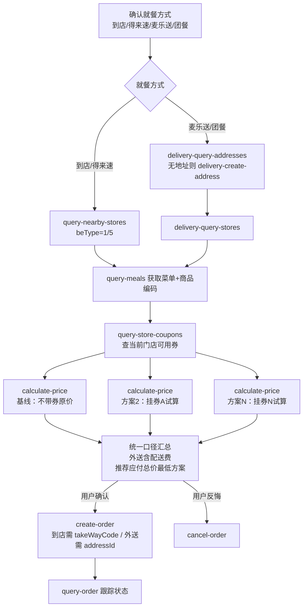

# MCP 集成说明（MCP_INTEGRATION）

本文档说明本项目实际使用的麦当劳 MCP Server、工具（Tool）、调用流程与业务价值。

## 一、使用的 MCP Server

| 项目 | 说明 |
|------|------|
| Server 名称 | mcd-mcp（麦当劳中国 MCP Server） |
| 接入地址 | `https://mcp.mcd.cn` |
| 传输协议 | Streamable HTTP |
| 鉴权方式 | 请求头 `Authorization: Bearer YOUR_MCP_TOKEN` |
| Token 获取 | [麦当劳 MCP 开放平台](https://open.mcd.cn/mcp) 申请 |
| 服务范围 | 中国大陆地区（不含港澳台） |
| 限流约束 | 每个 Token 每分钟最多 600 次请求，超限返回 429 |

> 本项目仓库中所有配置一律使用 `YOUR_MCP_TOKEN` 占位符，不含真实 Token。

## 二、使用的 Tool 清单

本项目（麦门省钱助手）围绕"省钱"场景，实际调用以下麦当劳 MCP 工具：

### 1. 券务工具（省钱核心）

| Tool | 名称 | 在本项目中的用途 |
|------|------|------------------|
| `available-coupons` | 麦麦省券列表查询 | 工作流 A：查询当前可领优惠券 |
| `auto-bind-coupons` | 麦麦省一键领券 | 工作流 A：零成本批量领取所有可领券 |
| `query-my-coupons` | 我的优惠券查询 | 工作流 A/D：确认领券到账、卡包资产盘点 |
| `query-store-coupons` | 门店可用券查询 | 工作流 B：查指定门店+订单类型下可用的券（比价数据源） |

### 2. 点餐与比价工具

| Tool | 名称 | 在本项目中的用途 |
|------|------|------------------|
| `query-nearby-stores` | 查询附近可用门店 | 工作流 B：到店自取/得来速场景选店（得来速需透传 beCode） |
| `delivery-query-addresses` | 获取可配送地址列表 | 工作流 B：外送场景前置查询 |
| `delivery-create-address` | 新增配送地址 | 工作流 B：用户无配送地址时创建 |
| `delivery-query-stores` | 查询可配送门店 | 工作流 B：麦乐送/团餐场景选店（取 beCode） |
| `query-meals` | 查询可售餐品列表 | 工作流 B/E：获取商品编码（productCode）与随单购商品 |
| `query-meal-detail` | 查询餐品详情 | 工作流 B/E：套餐组成与特制选项（E 中作跨平台规格对照基准） |
| `calculate-price` | 商品价格计算 | **工作流 B/E 核心：多券方案矩阵试算，输出含优惠的应付总价（E 的官方渠道基准价）** |
| `create-order` | 创建订单 | 工作流 B：按最优方案下单 |
| `query-order` / `order-list` / `cancel-order` | 订单查询/历史/取消 | 工作流 B：支付后跟踪、历史追溯、反悔取消 |

### 3. 积分与商城工具

| Tool | 名称 | 在本项目中的用途 |
|------|------|------------------|
| `query-my-account` | 我的积分查询 | 工作流 C/D：积分余额、**即将过期积分提醒** |
| `mall-points-products` | 麦麦商城商品列表 | 工作流 C：积分可兑换商品（支持类目筛选） |
| `mall-product-detail` | 商城商品详情 | 工作流 C：兑换前查看有效期与说明 |
| `mall-create-order` | 积分兑换下单 | 工作流 C：积分变现 |
| `mall-order-list` / `mall-order-detail` | 商城订单查询/详情 | 工作流 C：兑换记录追踪 |
| `query-lottery-info` / `draw-lottery` / `query-my-prizes` | 积分抽奖三件套 | 工作流 C：抽奖活动披露与执行（先披露消耗规则再执行） |

### 4. 辅助工具

| Tool | 名称 | 在本项目中的用途 |
|------|------|------------------|
| `now-time-info` | 获取当前时间信息 | 涉及"今天/本月"语义与预约场景前校准时间 |
| `campaign-calendar` | 活动日历查询 | 活动雷达：当月营销活动，发现可领券活动衔接工作流 A |

> 未使用的工具（如派对预订 `party-*`、团餐助餐 `query-meal-assistance`、营养 `list-nutrition-foods` 等）不在本项目省钱链路内，故未集成。

## 三、调用流程

### 工作流 E：跨平台比价（招牌能力）

解决"抖音 / 美团 / 官方小程序哪个便宜"的跨平台比价需求。设计原则：**官方渠道由 MCP 精确计算，外部平台价格由用户报数录入（只录不猜），比价结论用总账口径。**

```
E1 锁定比价标的（商品 + 就餐方式）
        │
        ▼
E2 官方渠道精算 ────── 复用工作流 B1–B3：
        │               到店最优到手价（优惠券矩阵试算）
        │               麦乐送含配送费到手价（外送意向时）
        │               积分可兑方案（衔接工作流 C）
        ▼
E3 外部报价录入 ────── 询问用户："抖音/美团上多少钱？套餐里有什么？"
        │               解析：平台 / 价格 / 套餐内容 / 限制条件
        ▼
E4 口径对齐 ───────── ① 规格对齐（query-meal-detail 对照套餐组成，不同则折算）
        │               ② 就餐方式对齐（到店核销券在外送需求下出局）
        │               ③ 总价口径（统一为含配送费的到手总价）
        ▼
E5 总账对比与推荐 ──── 对比表：渠道/到手总价/规格/就餐方式/限制
                        过滤 → 按价排序 → 价差<2元叠加便利性分析
                        → 选官方渠道则衔接 B4 下单
```

### 工作流 A：每日领券

```
available-coupons（查可领券）
        │
        ▼
auto-bind-coupons（一键领取全部）
        │
        ▼
query-my-coupons（确认到账）──→ 汇报"领到 N 张券"，按可省金额排序展示
```

### 工作流 B：省钱点餐（官方渠道精算引擎，E 的内核）



**关键设计**：

1. **多券矩阵试算**——对"基线原价 + 每张门店可用券"分别调用 `calculate-price`，生成方案对比表，而不是凭券面金额猜测哪张更划算；
2. **统一比价口径**——外送场景必须把配送费计入应付总价后再比较；
3. **参数透传链**——`storeCode` / `beCode` / `reservationDate` 在选店后的所有工具调用中原样透传，避免上下文丢失；
4. **金额换算**——`calculate-price` 返回金额单位为分，统一除以 100 转元后展示。

### 工作流 C：积分变现

```
query-my-account（查积分+即将过期积分）
        │
        ▼ 有即将过期积分或用户主动询问
mall-points-products（查可兑换商品，catRuleIds 类目筛选）
        │
        ▼
mall-product-detail（查详情） ──→ mall-create-order（积分兑换下单）
        │
        ▼
mall-order-list / mall-order-detail（兑换记录追踪）
```

### 工作流 D：资产盘点

```
query-my-coupons（卡包券） ┐
                          ├─ 并行 ──→ 券按到期优先排序 + 积分过期提醒 ──→ 衔接工作流 B/C
query-my-account（积分）   ┘
```

## 四、业务价值

1. **终结"三 App 手工比价"**：点一份麦当劳，用户要在抖音、美团、小程序之间来回切换，还要心算配送费、券门槛、有效期。本项目将其收敛为一句话——官方渠道由 MCP 精确计算到分，外部平台用户只报一个数，总账由 AI 对齐口径后算清，直接回答"去哪个渠道买"。

2. **从"凭感觉用券"到"用最优方案下单"**：券面金额 ≠ 实际到手优惠（门槛、适用门店、配送费都会影响）。通过 `calculate-price` 对每张券真实试算、统一口径比较，确保推荐的是**应付总价最低**的方案；跨平台场景下进一步过滤"便宜但送不了/规格不同/有时段限制"的假性优惠（工作流 E 的三重口径对齐）。

3. **可信的比价设计**：外部价格"只录不猜"——抖音/美团报价一律由用户提供，无法核实的限制条件如实标注"以券面规则为准"，绝不虚构外部数据；官方渠道侧则以 MCP 真实试算为准，两侧数据来源都可信。

4. **被动资产主动化管理**：领券（工作流 A）让用户不再错过麦麦省上新；即将过期积分提醒（工作流 C）让沉睡积分完成变现，避免白白过期。

5. **可复用的 Skill 化交付**：本项目以 WorkBuddy Skill 形式交付，工作流编排、工具速查知识（`references/tools-guide.md`）与跨平台比价知识库（`references/platform-deals.md`）沉淀为可分发的技能包，任何 WorkBuddy 用户接入麦当劳 MCP 后即可零代码复用整套省钱链路。
